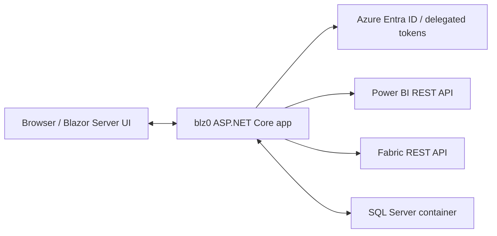
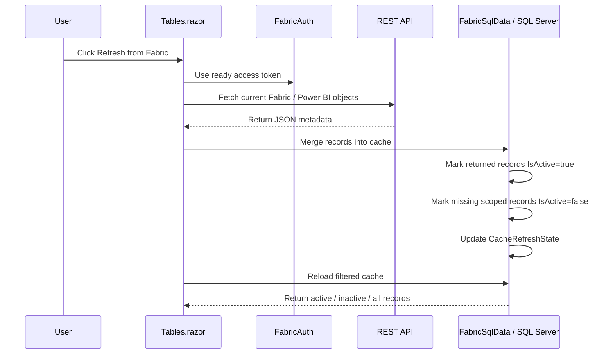

# blz0 Architecture

## Purpose

`blz0` is a Blazor Server application for browsing Microsoft Fabric / Power BI metadata. It reads capacities, workspaces, datasets and reports from the Power BI REST API, reads lakehouses and warehouses from the Fabric REST API, stores a local SQL Server cache, and renders cached data in interactive tables.

The current operating model is:

- the UI always displays SQL cache data,
- `Refresh from Fabric` explicitly calls the Power BI REST API or Fabric REST API,
- API results are merged into SQL,
- records missing from the latest refresh are marked inactive instead of deleted.
- lakehouse and warehouse details use a fresh Fabric REST workspace list call and select the requested item by id.

## Runtime Topology



## Main Projects

- `blz0/blz0` - ASP.NET Core / Blazor Server app, server-side services, EF Core context, pages and operations.
- `EventLogProcessing` - supporting project for event log related functionality.

## Important Layers

### UI

Blazor pages live in `blz0/blz0/Components/Pages`.

- `Capacities.razor`
- `Workspaces.razor`
- `Datasets.razor`
- `Reports.razor`
- `Lakehouses.razor`
- `Warehouses.razor`
- `Tables.razor`
- `Dashboard.razor`
- `TokenState.razor`

`Tables.razor` is the shared table component. It receives `FabricObjectType`, `capacityIdNav` and `workspaceIdNav` as cascading parameters and decides which cached dataset to load.

### Authentication

`Authorization/FabricAuth.cs` creates delegated API clients:

- Power BI REST uses `https://analysis.windows.net/powerbi/api/.default`.
- Fabric REST list/details for lakehouses and warehouses use `https://api.fabric.microsoft.com/Workspace.Read.All`.
- Lakehouse table listing uses `https://api.fabric.microsoft.com/Lakehouse.Read.All`.
- Warehouse table listing connects to the Fabric SQL endpoint with an Azure SQL token for `https://database.windows.net/.default`.

In development the app is configured to use a service principal from `appsettings.Development.json` / environment variables instead of relying on Visual Studio or Azure CLI credentials inside the dev container.

### API Access

`Operations/FabricApiData.cs` calls the Power BI REST API:

- capacities: `/capacities`
- workspaces: `/groups`
- datasets: `/groups/{workspaceId}/datasets`
- reports: `/groups/{workspaceId}/reports`

Datasets and reports are workspace-scoped in the Power BI REST API. When the app is on `/datasets` or `/reports` without a workspace id, refresh loops over active workspaces stored in SQL.

It also calls Fabric REST API for:

- lakehouses: `/v1/workspaces/{workspaceId}/lakehouses`
- warehouses: `/v1/workspaces/{workspaceId}/warehouses`

Fabric lakehouse/warehouse APIs are workspace-scoped. Global refresh loops over accessible workspaces. Workspaces that return `WorkspaceTypeNotSupported` are skipped because not every Power BI workspace supports Fabric item APIs.

### SQL Cache

`Operations/FabricSqlData.cs` owns cache reads and writes.

The cache tables are:

- `Capacity`
- `Workspace`
- `Dataset`
- `Report`
- `Lakehouse`
- `Warehouse`
- `CacheRefreshState`

Each cached Fabric object has:

- `InsertDate`
- `UpdateDate`
- `IsActive`

`IsActive` is the soft-delete flag. A refresh marks records returned by the API as active and marks records missing from the refreshed scope as inactive.

### EF Core

`Data/blz0Context.cs` is the EF Core context. Migrations live in `blz0/blz0/Migrations`.

Current notable migrations:

- `AddCacheRefreshState`
- `AddIsActiveToCachedObjects`

### Static Assets

`Components/App.razor` loads Bootstrap from CDN, but the repository keeps a local Bootstrap copy in `wwwroot/lib/bootstrap` as a fallback for Docker/dev environments where CDN access can be unreliable.

Bootstrap Icons are restored locally through `libman.json` into `wwwroot/lib/bootstrap-icons` and are loaded from local static files. The restored set is intentionally limited to the icon font CSS and font files used by `bi ...` classes.

## Data Refresh Flow



## Cache Filtering

The table toolbar has three record status filters:

- `Active` - only current records from the latest refresh scope.
- `Inactive` - records retained in SQL but missing from the latest refresh scope.
- `All` - both active and inactive records.

The timestamp badge shows `CacheRefreshState.RefreshedAtUtc` and `RowCount`.

## Local Development

The intended macOS setup is:

- VS Code Dev Containers for .NET tooling.
- SQL Server in Docker.
- No global .NET SDK installation required on macOS.
- Local Bootstrap Icons can be restored with `libman restore` from `blz0/blz0`.

Typical SQL Server container:

```bash
docker run \
  --platform linux/amd64 \
  -e "ACCEPT_EULA=Y" \
  -e "MSSQL_SA_PASSWORD=CHANGE_ME" \
  -p 1433:1433 \
  --name blz0-sqlserver \
  -d mcr.microsoft.com/mssql/server:2025-latest
```

Development connection string:

```text
Server=host.docker.internal,1433;Database=FabricDB;User Id=sa;Password=CHANGE_ME;TrustServerCertificate=True;Encrypt=True;
```

## Known Design Notes

- The app currently stores Fabric metadata in scoped services as public lists. This works for the current UI, but a future cleanup should return data from service methods instead of mutating service fields.
- `Tables.razor` still contains repeated grid markup for API/SQL-era branches. Since the app now always renders SQL cache data, this can be simplified further.
- Power BI datasets and reports are workspace-scoped. Refreshing all datasets/reports depends on active workspaces already existing in the SQL cache.
- Fabric lakehouses and warehouses are also workspace-scoped. Global refresh intentionally skips unsupported workspace types instead of failing the whole refresh.
- Lakehouse/warehouse details use REST reads rather than SQL cache where possible. To avoid requiring broader `Item.Read.All` consent in this demo, details call the workspace list endpoint and select the requested item by id.
